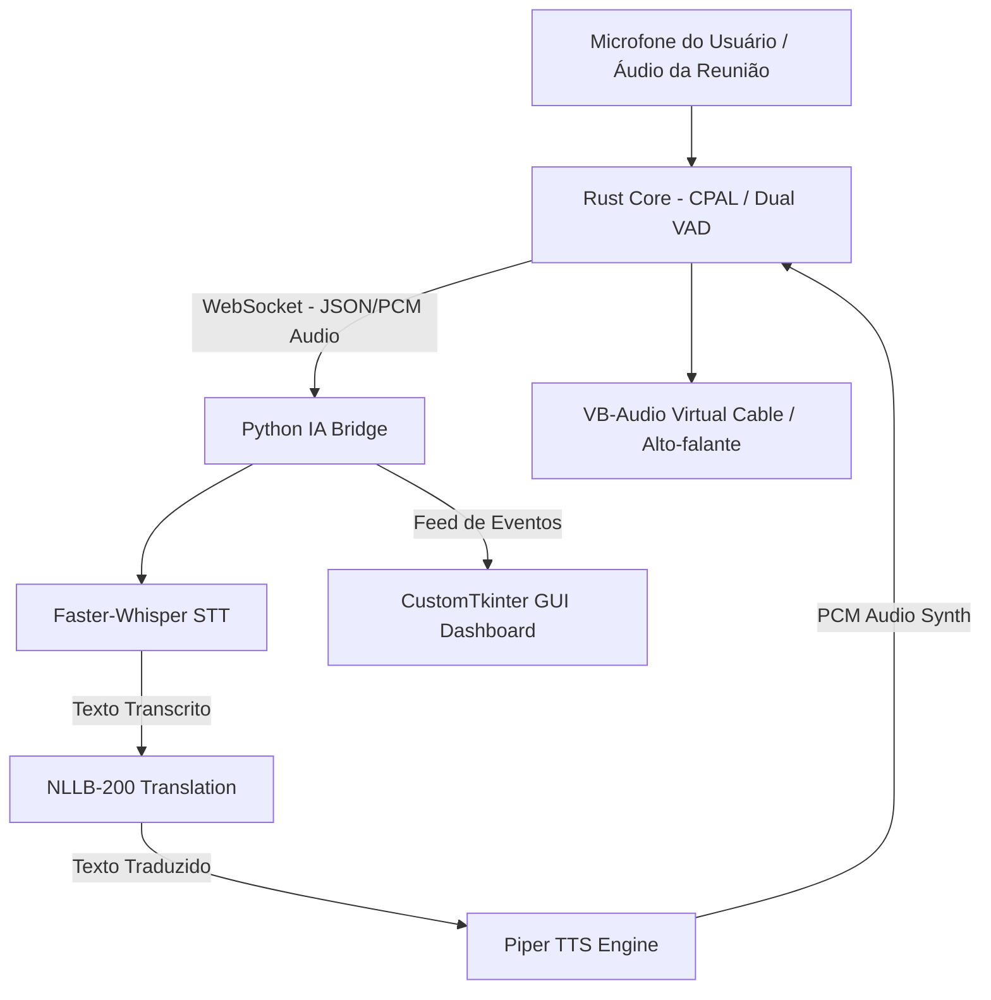

# 🎙️ Voxly — Tradução e Transcrição de Voz em Tempo Real

<p align="center">
  
  
  
  
  
  
</p>

**Voxly** é um sistema avançado e de baixa latência para **transcrição, tradução neural e sintetização de voz em tempo real (Bi-direcional)**. Desenvolvido para reuniões online (Zoom, Google Meet, Teams, Discord), chamadas internacionais e atendimento, o Voxly permite traduzir simultaneamente o áudio do seu microfone para quem está ouvindo e o áudio da reunião de volta para você em seu idioma nativo.

---

## 🌟 Principais Recursos

- ⚡ **Arquitetura Híbrida de Alta Performance**:
  - **Core de Áudio em Rust**: Gerenciamento de buffers de áudio, streaming CPAL ultra-leve e comunicação via WebSockets.
  - **Motor de IA em Python (CTranslate2)**: Execução otimizada em CPU/GPU dos modelos de IA sem travamentos.
- 🎙️ **Dual VAD (Voice Activity Detection) Inteligente**:
  - Distinção clara e isolada entre a sua fala (**Microfone**) e a fala dos outros (**Áudio da Reunião/Loopback**).
  - Suporte a **Push-To-Talk (PTT)** por tecla de atalho para evitar envios acidentais e sobreposição de áudio.
- 🗣️ **STT (Speech-to-Text) com Faster-Whisper**:
  - Transcrição precisa com suporte a múltiplos modelos (`base`, `small`, `medium`).
  - Reconhecimento automático de idiomas e *prompting* contextual.
- 🌐 **Tradução Neural Avançada (NLLB-200)**:
  - Modelos `NLLB-200` (600M, 1.3B e 3.3B) via CTranslate2.
  - **Filtro Anti-Eco e Memória Contextual**: Evita repetições e garante traduções fluidas de frases longas.
- 🔊 **Sintetizador de Voz Natural (Piper TTS)**:
  - Vozes neuronais em ONNX com controle de velocidade e vozes masculinas/femininas.
  - Reprodução automática no canal virtual de saída (VB-Cable).
- 🛠️ **Configuração Automática de Drivers**:
  - Verificação e instalação silenciosa de **FlexASIO** e **VB-Audio Virtual Cable**.
- 🎛️ **Interface Gráfica Moderna (CustomTkinter)**:
  - Painel escuro elegante com histórico de transcrição e tradução em tempo real, seleção de áudio de entrada/saída e escolha de mais de 90 idiomas.
- 📦 **Empacotamento Standalone Pronto**:
  - Script automatizado de compilação em lote (`build_windows_app.bat`) que gera uma versão pronta para distribuição sem necessidade de instalar Python na máquina do usuário.

---

## 🏗️ Arquitetura do Sistema



---

## 🌎 Idiomas e Vozes Suportados

O Voxly suporta **mais de 90 idiomas** para transcrição e tradução, com suporte nativo a vozes sintetizadas (TTS) para os principais idiomas:

| Idioma | Código Whisper | Código NLLB | Vozes Padrão (Piper TTS) |
|---|---|---|---|
| **Português (Brasil)** | `pt` | `por_Latn` | Faber (Masculino), Alan (Masculino/Low) |
| **Português (Portugal)** | `pt` | `por_Latn` | Duarte (Masculino) |
| **Inglês (US)** | `en` | `eng_Latn` | Lessac (Feminino), Ryan (Masculino), Joe (Low) |
| **Inglês (UK)** | `en` | `eng_Latn` | Alan (Masculino), Alba (Feminino) |
| **Espanhol (Espanha / México)** | `es` | `spa_Latn` | Sharvard (Fem), Carlitos (Masc), Claude (Masc) |
| **Francês** | `fr` | `fra_Latn` | Siwis (Feminino), Gilles (Masculino) |
| **Alemão** | `de` | `deu_Latn` | Thorsten (Masculino), Eva (Feminino) |
| **Italiano** | `it` | `ita_Latn` | Paola (Feminino), Riccardo (Masculino) |
| **Japonês, Chinês, Coreano, Russo, etc.** | `ja`, `zh`, `ko`, `ru` | `jpn_Jpan`, `zho_Hans` ... | Hina, Huayan, Sun-Hi, Irina, etc. |

---

## 📋 Pré-requisitos

### Para Executar o Projeto (Código Fonte)

- **Sistema Operacional**: Windows 10 ou Windows 11 (64-bit).
- **Rust toolchain** (Cargo): [rustup.rs](https://rustup.rs/)
- **Python**: 3.10 ou superior.
- **Git** instalado.

---

## 🚀 Como Instalar e Rodar

### 1. Clonar o Repositório

```bash
git clone https://github.com/Davi658/Voxly.git
cd Voxly
```

### 2. Configurar o Ambiente Python

```bash
python -m venv .venv
.venv\Scripts\activate
pip install pyinstaller faster-whisper websockets numpy sounddevice soundfile ctranslate2 transformers huggingface-hub piper-tts customtkinter darkdetect
```

### 3. Compilar o Core Rust

```bash
cargo build --release
```

### 4. Executar o Voxly

Para rodar a interface gráfica completa:

```bash
python voxly_launcher_gui.py
```

> **Nota**: Ao iniciar pela primeira vez, o Voxly verificará se o **FlexASIO** e o **VB-Audio Virtual Cable** estão instalados e os instalará automaticamente se necessário.

---

## 📦 Gerar a Versão Standalone (.exe sem Python)

Se deseja empacotar o projeto em um executável pronto para distribuição:

```cmd
build_windows_app.bat
```

Este script compila o Rust em `--release`, empacota o backend Python com PyInstaller e monta a pasta `Voxly_App_Standalone/` contendo tudo o que é necessário para rodar o app em qualquer computador Windows sem dependências externas!

---

## ⚙️ Arquivo de Configuração (`voxly_config.json`)

Você pode personalizar os comportamentos do Voxly via interface gráfica ou editando o arquivo `voxly_config.json`:

```json
{
  "input_lang_name": "Português (Brasil)",
  "output_lang_name": "Inglês (US)",
  "input_nllb": "por_Latn",
  "input_whisper": "pt",
  "output_nllb": "eng_Latn",
  "output_piper": "en_US",
  "tts_voice": "Lessac (Feminino)",
  "tts_speed": 1.2,
  "translate_inbound": true,
  "performance_profile": "med",
  "whisper_model": "small"
}
```

- **`performance_profile`**: Ajusta o consumo de recursos (`low`, `med`, `high`).
- **`whisper_model`**: Modelo do Whisper (`base`, `small`, `medium`).
- **`tts_speed`**: Fator de velocidade do sintetizador de voz (ex: `1.0`, `1.2`).

---

## 📄 Licença

Este projeto está sob a licença [MIT](LICENSE).

---

## 👤 Autor

Desenvolvido por **[Davi Diniz (Davi658)](https://github.com/Davi658)**.
